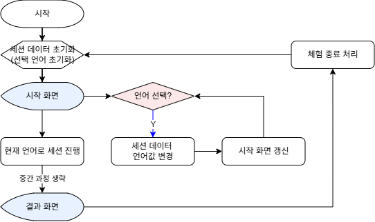
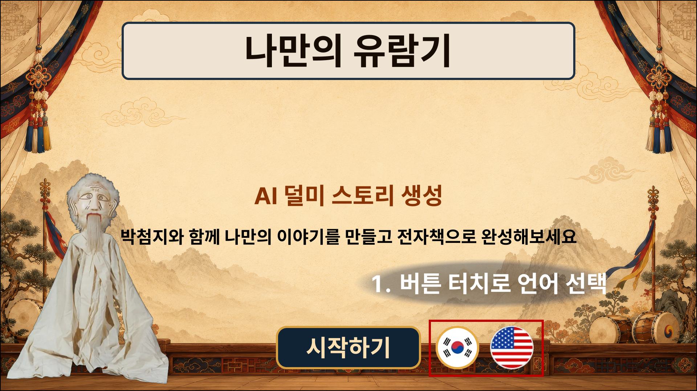
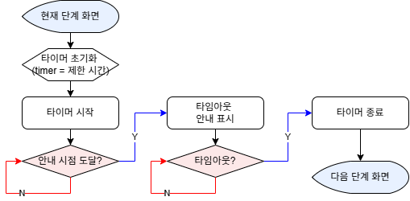
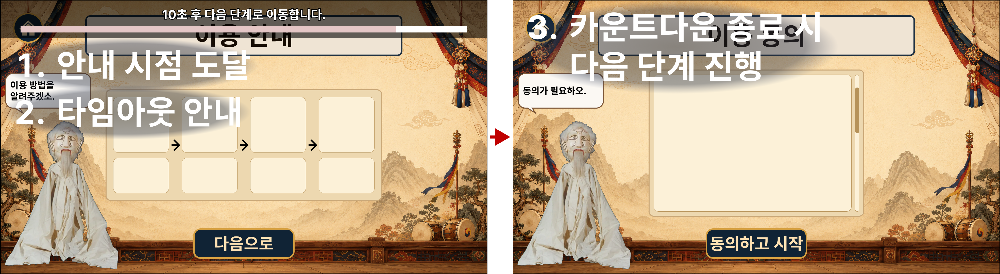
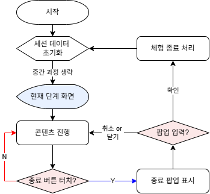
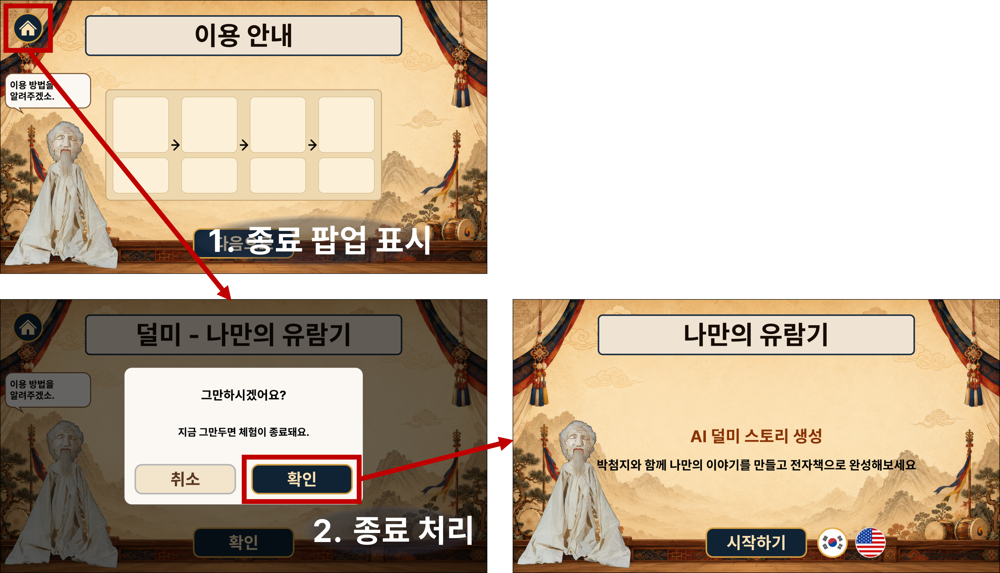
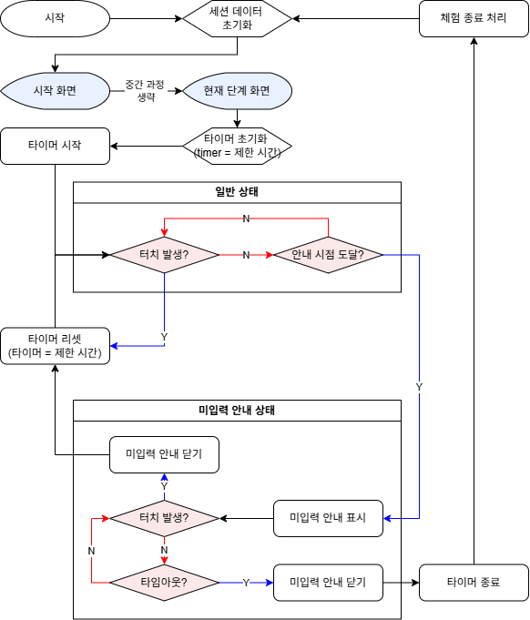
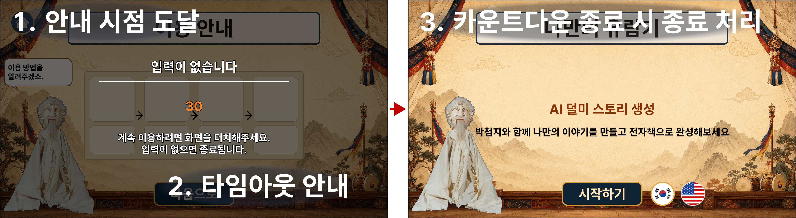
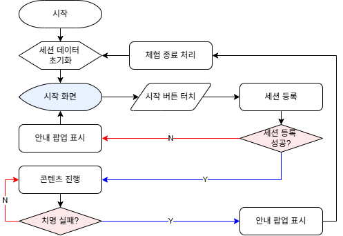
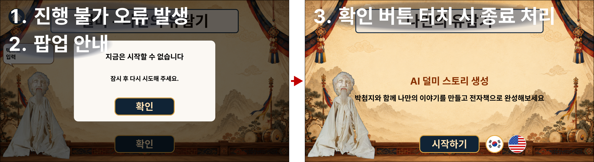

# 문서 정보

| 버전    | 날짜         | 내용    | 항목  | 작성자 |
| ----- | ---------- | ----- | --- | --- |
| 1.0.0 | 2026.10.02 | 초안 작성 | 전체  | 조상연 |

# 1 개요

## 1.1 콘텐츠 개요

- **콘텐츠 정의**
	- 남사당놀이 덜미 2개 마당 7개 거리 중 꼭두각시 거리를 체험하는 키오스크 콘텐츠
- **개발 목적**
	- 무형문화유산의 형식과 포함된 의미를 사용자와 실시간으로 상호작용하며 체험 및 학습할 수 있는 수단 제공
- **개발 범위**
	- 현대 사람들도 공감하기 쉬운 치정극이라는 소재와 간단한 구성(박첨지, 꼭두각시, 덜머리집)을 가진 꼭두각시 거리를 우선 개발
## 1.2 핵심 시스템

- **조종 원리 시각화 시스템**
	-  유저 동작을 외형 인형과 구조 인형에 동시에 연동하여 움직임 및 조작 원리 시각화
		- 조작 체험 구현의 경우 난이도가 높기 때문에 체험 대신 구조 학습 수단 제공
- **병렬 서사 시스템**
	- 전경의 유저 인형과 원경의 덜미 인형극을 병렬로 진행하며 이야기의 큰 흐름은 유지하면서 유저 행동이 세부 진행을 바꿔 두 장면이 합쳐진 웃음을 만드는 시스템
		- 유저의 체험에 큰 제약을 두지 않으면서 인형극 진행에 복잡한 분기를 두지 않아 매끄러운 진행 유도
- **유저 성향 평가 시스템**
	- 유저의 행동을 토대로 성향을 평가하여 마무리 화면에 표시
		- 병렬 서사 시스템에서 유저가 한 행동과 유저의 성향을 연결시켜 유저의 행동에 의미 부여
- **사진 기반 인형 생성 시스템**
	- 유저의 얼굴 촬영 뒤 생성형 AI를 이용하여 목각인형으로 변환
		- 병렬 서사 시스템에서 사용할 유저 인형이 필요하며 몰입감을 높이기 위해 공통 인형 대신 유저 전용 인형 사용

# 2 전체 플로우

# 3 공통 시스템

## 3.1 세션 데이터

### 3.1.1 역할과 목적

- **정의**
	- 세션 진행 중 필요한 상태, 선택 및 수행 기록 등을 통합 관리하는 데이터
- **목적**
	- 콘텐츠 진행에 필요한 데이터를 체계화하여 **진행 상태 관리 및 데이터 관리 편의성 향상**

### 3.1.2 구성

| 데이터       | 값                                                    |
| --------- | ---------------------------------------------------- |
| 세션 ID     | 세션마다 부여되는 고유 식별자                                     |
| 현재 언어     | 세션에 적용 중인 언어 (기본값: 한국어)                           |
| 현재 단계     | 현재 진행 중인 단계 (시작, 가이드, 이용 동의, 인형 생성, 꼭두각시 체험, 마무리) |
| 에러 유형     | 에러 발생 시 확인된 에러 유형 (기본값: None)                     |
| 동의 내역     | 약관 버전, 동의 시각 기록                                      |
| 체험 단계     | 꼭두각시 거리의 진행 단계                                       |
| 수행 기록     | 각 행동 별로 행동 유형, 대상, 소품, 개입도와 해결도 기록                   |
| 성향 평가 결과  | 최종 개입도, 최종 해결도, 최종 성향                                |
| 기억에 남는 행동 | 선정된 행동 묶음 최대 3개                                      |
| 아바타       | 생성된 3D 아바타 자산                                        |

## 3.2 언어 선택

### 3.2.1 개요

- **정의**
	- 세션 진행 시 사용할 텍스트 언어를 결정하는 시스템
- **목적**
	- 비한국어권 유저에게도 원활한 콘텐츠 참여 기회 제공

### 3.2.2 동작 방식

 

#### 1) 언어 선택 및 적용

- **기본값 설정**
	- 세션 데이터 초기화 시 **한국어**로 설정
- **언어 선택 시 처리**
	- 해당 언어를 세션 데이터에 적용 후 화면 갱신 실행
- **적용 범위**
	- 텍스트에만 적용하며 음성은 적용하지 않음

### 3.2.3 설정

#### 1) Localization 데이터

- JSON 파일로 관리

#### 2) 고려 사항

- 추후 프로젝트의 콘텐츠를 통합하게 되어 콘텐츠 선택 단계가 추가될 경우 언어 선택 시스템의 적용 위치를 통합 시작 화면으로 이전해야 하므로 개발 시 고려 필요

## 3.3 화면 타임아웃

### 3.3.1 개요

- **정의**
	- 한 화면에서 일정 시간(예: 60초) 이상 머무를 경우 다음 단계로 넘어가는 시스템
- **목적**
	- 유저의 장시간 키오스크 체류를 방지하여 키오스크 회전율 제고

### 3.3.2 동작 방식

 

#### 1) 타임아웃

- 현재 단계 화면 진입 시 타이머 초기화 후 카운트다운 시작
- 카운트다운 종료 시 타이머 종료하고 다음 단계 진행

#### 2) 예외 처리

- 필수 입력이 필요한 화면(Ex. 이용 동의 화면, 텍스트 입력 화면)이나 생성 대기 화면에서는 사용하지 않음

#### 3) 기획서에서의 표시

- 해당 시스템이 적용되는 화면에는 상기 아이콘 표시

## 3.4 중도 종료

### 3.4.1 개요

- 정의
	- 유저의 자발적 이탈 또는 비정상적인 세션 중단 시 세션을 정상 종료하는 시스템
- 목적
	- 비정상적인 상황에서 세션이 종료되지 않은 채 유지되는 것을 방지하여 키오스크 회전율 제고

### 3.4.2 동작 방식

#### 1) 진행 중 종료 선택 시 처리

 

##### (1) 적용 조건

- 유저가 종료 버튼 터치 시 적용

##### (2) 처리 방식

- 종료 팝업 생성 후 확인 버튼 터치 시 종료 처리

#### 2) 미입력 타임아웃 시 처리

 

##### (1) 적용 조건

- 세션 진행 중 일정 시간 동안 화면 터치 입력이 없는 경우 적용

##### (2) 처리 방식

- 각 단계 화면 진입 시 미입력 타이머 시작
	- 미입력 터치아웃 UI는 레이어 최상단에 위치
- 화면 터치가 발생하면 타이머 초기화
- 안내 시점까지 입력이 없으면 미입력 안내 표시
- 안내 중 화면을 터치하면 안내를 닫고 타이머 초기화 후 현재 단계 계속 진행
- 안내 후 제한 시간까지 입력 없을 시 미입력 안내 닫고 종료 처리

##### (3) 기획서에서의 표시

- 해당 시스템이 적용되는 화면에는 상기 아이콘 표시

#### 3) 세션 진행 실패 시 처리

 

##### (1) 적용 조건

- 세션 등록 실패
	- 서버에 클라이언트의 세션 데이터를 전송 실패
	- 서버에서 세션 ID 부여 실패
- 체험 진행이 불가능한 오류 발생
	- 체험 콘텐츠 리소스 로드 실패, 카메라 및 인식 계통의 지속적 장애 발생

##### (2) 처리 방식

- 재시도(2회) 후 계속 오류 상태일 경우 오류 안내 팝업 표시 후 체험 종료 처리
- 세션 등록 실패 시 종료할 세션이 없으므로 체험 종료 처리 없이 시작 화면으로 복귀

## 3.5 바닥면 처리

### 3.5.1 개요

- **정의**
	- 키오스크의 바닥면 투사 기능과 유저 동작 감지 기능을 연동하여 선택한 남사당놀이 종목에 맞는 이미지를 바닥에 투사하고 유저가 발을 디딘 위치에 시각 효과를 표시하는 상호작용 시스템
- **목적**
	- 바닥면까지 체험 영역으로 확장하여 선택한 종목의 분위기와 특징을 공간적으로 전달
	- 유저의 발 동작에 즉각적인 시각 피드백을 제공하여 체험의 몰입감과 참여감 향상

### 3.5.2 동작 방식

- **진행**
	- 선택한 마당과 체험 단계에 맞는 배경 이미지를 바닥에 투사
	- 센서로 유저의 발 위치를 감지하고 감지한 위치에 시각 효과를 표시
	- 유저가 움직이면 발 위치를 다시 감지하고 시각 효과의 표시 위치를 실시간으로 갱신
- **장비 연동**
	- 설치 시 프로젝터의 투사 좌표와 센서의 감지 좌표를 맞춰 하나의 체험 영역으로 설정
	- 투사 범위와 감지 방식 등 세부 기준은 프로젝터와 센서 선정 후 확정

# 4 콘텐츠 시스템

## 4.1 조종 원리 시각화 시스템

### 4.1.1 개요

- **정의**
	- 유저 동작을 외형 인형과 내부 조종 구조를 보여주는 구조 인형에 동시에 연동하는 시스템
- **목적**
	- 유저에게 인형의 움직임과 내부 구조의 관계를 동시에 보여주어서 유저가 인형 조작 원리를 이해할 수 있도록 함
	- 실제 손동작 조작을 재현하는 어려움을 줄이고 몸동작으로 쉽게 배울 수 있도록 함

### 4.1.2 동작 방식

1. 유저가 유저 식별 및 등록을 마치고 키오스크 앞에서 동작을 취함
	- 
2. 유저의 동작에서 기울임, 회전, 팔 휘두름 값 등 인형 움직임에 필요한 값을 산출하고 외형 인형과 구조 인형에 연동
	- 유저의 동작을 그대로 인형에 반영하는 것이 아니라 인형이 움직일 수 있는 한계치까지만 반영
3. 외형 인형으로 겉의 움직임 시각화
4. 구조 인형으로 내부 조작 부위 작동 시각화

## 4.2 병렬 서사 시스템

### 4.2.1 개요

- **정의**
	- 전경의 유저 인형과 원경의 덜미 인형극을 병렬로 진행하고 유저 행동을 원경의 세부 진행에 반영하는 시스템
- **목적**
	- 유저의 행동을 폭넓게 허용하면서 이야기의 큰 흐름을 유지함
	- 유저 행동과 인형극의 반응이 어우러져 웃음을 만들고 몰입감을 높임

### 4.2.2 동작 방식

1. 원경 배경 설치
2. 중경 배경 설치
3. 근경 배경 설치
4. 원경과 중경 사이에 꼭두각시 거리 인형 배치
	- 꼭두각시 거리 인형극 진행
5. 중경과 근경 사이에 유저 인형과 소품 오브젝트 배치
	- 유저 행동에 따라 인형극 진행의 대사가 바뀜
	- 인형극의 큰 흐름은 유지

### 4.2.3 소품 배치

- 소품 배치 순서는 별도 JSON 파일로 관리
- 소품은 한 번에 하나씩 배치
	- 소품은 인형의 오른손에 자동 배치되어 획득 처리
- 배치된 소품은 일정 시간 경과 시 사라지고 다음 순번의 소품 배치 진행

### 4.2.4 동작 연동

| 인형 동작     | 조건                | 유저 동작 및 처리                                             |
| --------- | ----------------- | ------------------------------------------------------ |
| 소품 던지기    | 소품 획득             | 팔을 위로 올렸다가 아래로 휘두르면 소품이 날아감                            |
| 소품 전달     | 소품 획득             | 유저 인형의 손에 있는 소품이 다른 인형의 충돌체와 충돌했을 경우 소품이 해당 인형의 발치로 이동 |
| 소품 쥔 손 교체 | 소품 획득             | 유저가 일정 각도 이상 몸을 기울이면 기울인 방향의 손으로 소품 배치                 |

## 4.3 유저 성향 평가 시스템

### 4.3.1 개요

- **정의**
	- 체험 중 유저의 행동을 해석해 성향을 평가하고 마무리 화면에 보여주는 시스템
- **목적**
	- 인형극에 참여한 행동에 의미를 부여하고, 자신의 체험을 돌아보게 함

### 4.3.2 동작 방식

#### 1) 개입도

##### (1) 선택 행동의 기록

- 유저가 실제로 한 행동을 1건씩 집계함
	- 소품은 획득부터 조작이 끝날 때까지를 1건으로 셈
	- 박첨지 울음에서 왼팔이나 오른팔을 올린 행동도 1건으로 셈
	- 대기도 행동 1건으로 셈
- 행동마다 장면, 소품이나 인물, 실제 한 행동, 전달 대상과 반응을 기록함.
- 이동, 기울이기와 손 교체는 집계에서 제외함

##### (2) 집계 방식

| 기록 대상    | 집계 방식                           |
| -------- | ------------------------------- |
| 전체 선택 횟수 | 대기를 포함한 모든 선택 기록의 횟수            |
| 대기 횟수    | 조작하지 않고 대기로 끝난 횟수               |
| 개입 횟수    | 전달, 던지기, 다독이기, 때리기를 실행한 횟수      |
| 해결 행동 횟수 | 개입한 행동 중 해결로 평가된 횟수             |
| 중립 행동 횟수 | 개입한 행동 중 중립으로 평가된 횟수. 대기는 제외 |
| 혼란 행동 횟수 | 개입한 행동 중 혼란으로 평가된 횟수            |

##### (3) 개입도 산출

- 개입 횟수 = 전체 선택 횟수 - 대기 횟수
- 개입률 = (개입 횟수 / 전체 선택 횟수) * 100

| 개입도 | 개입률             |
| --- | --------------- |
| 소극  | 0% 이상, 40% 미만   |
| 중간  | 40% 이상, 70% 미만  |
| 적극  | 70% 이상, 100% 이하 |

#### 2) 해결도

##### (1) 행동별 해결도

| 장면과 소품                                | 해결 행동             | 혼란 행동             | 중립 행동                |
| ------------------------------------- | ----------------- | ----------------- | -------------------- |
| 싸움: 찬물이 담긴 그릇                         | 덜머리집 또는 꼭두각시에게 전달 | 던지기               | 대기, 박첨지에게 전달         |
| 싸움: 노리개                               | 덜머리집에게 전달         | 던지기, 꼭두각시에게 전달    | 대기, 박첨지에게 전달         |
| 재산 분배: 오동 장롱 반다지, 자개 함롱 귀다지, 천석지기 땅문서 | 꼭두각시에게 전달         | 던지기               | 대기, 박첨지 또는 덜머리집에게 전달 |
| 재산 분배: 깨진 매운독, 부적가리, 세마지기 땅문서         | 없음                | 덜머리집 또는 꼭두각시에게 전달 | 대기, 던지기, 박첨지에게 전달    |
| 노잣돈: 엽전 꾸러미                           | 꼭두각시에게 전달         | 던지기               | 대기, 박첨지 또는 덜머리집에게 전달 |
| 박첨지 울음                                | 다독이기(왼팔 올리기)      | 때리기(오른팔 올리기)      | 대기                   |

##### (2) 해결도 산출

- 대기를 제외한 개입 행동을 행동별 해결도 표에 따라 해결, 중립, 혼란으로 분류하고 각각의 횟수를 집계함.
- 해결 행동 횟수, 중립 행동 횟수, 혼란 행동 횟수를 비교하여 최종 해결도를 정함.

| 최종 해결도 | 조건                                                                                                                           |
| ------ | ---------------------------------------------------------------------------------------------------------------------------- |
| 해결     | (해결 행동 횟수 > 중립 행동 횟수) and  (해결 행동 횟수 > 혼란 행동 횟수)                                                                          |
| 혼란     | (혼란 행동 횟수 > 해결 행동 횟수) and  (혼란 행동 횟수 > 중립 행동 횟수)                                                                          |
| 중립     | (개입 횟수 = 0) or  (중립 행동 횟수 >= 해결 행동 횟수) and (중립 행동 횟수 >= 혼란 행동 횟수) or  (해결 행동 횟수 = 혼란 행동 횟수) and (해결 행동 횟수 >= 중립 행동 횟수) |

#### 3) 최종 성향

개입도와 해결도를 판정표에 대입

| 개입도 | 해결      | 중립       | 혼란      |
| --- | ------- | -------- | ------- |
| 적극  | 적극 해결사  | 오지랖쟁이    | 천둥 벌거숭이 |
| 중간  | 은근한 조력자 | 유유자적 유람객 | 장난꾸러기   |
| 소극  | 조용한 수습꾼 | 태평한 구경꾼  | 슬쩍 사고뭉치 |

#### 4) 기억에 남는 행동

- 최종 성향 판정 후 성향에 맞는 행동을 최대 3개까지 저장
	- 3개 이하면 모두 선정
	- 3개 초과 시 랜덤으로 3개 선정하여 저장
	- 최다 건수가 동수여서 중립이 나왔을 경우 최다 횟수가 동률인 모든 분류를 선정 대상으로 함

## 4.4 사진 기반 인형 생성 시스템

### 4.4.1 개요

- **정의**
	- 촬영한 유저 얼굴을 생성형 AI로 목각인형 모습으로 변환하는 시스템
- **목적**
	- 유저를 닮은 전용 인형으로 인형극에 대한 몰입감을 높임

### 4.4.2 동작 방식

#### 1) 기본 진행

##### (1) 전체 플로우

##### (2) 사진 촬영

##### (3) 인형 생성

#### 2) 사진 촬영

- 촬영 횟수 초기화 -> 가이드 -> 대기 -> 촬영 및 횟수 차감 -> 결과 판정 순서로 진행
- 결과 양호 시 사진 임시 저장 후 종료
- 양호하지 않을 경우 N회 촬영 재시도
	- 촬영 재시도 횟수 모두 소진 시 촬영 실패 안내 후 세션 종료 처리

#### 3) 인형 생성

- 설정값 초기화 -> 대기 영상 반복 재생 -> 생성 요청 -> 상태 확인 순서로 진행
- 상태 확인 결과 생성 완료 시 작업
	- 인형 조립
		- 생성된 얼굴을 미리 준비한 몸통에 연결
	- 완료 알림 진행
	- 대기 영상은 현재 재생분까지만 재생하나 유저가 중도 종료할 수 있음
- 상태 확인 결과 처리 중일 경우 작업
	- 일정 간격으로 재확인하며 재확인 횟수 소진 시 과지연 안내 후 세션 종료
- 상태 확인 결과 실패 시 작업
	- 재요청 실행하고 재요청 횟수 소진 시 생성 실패 안내 후 세션 종료

# 5 인트로 진행

## 5.1 개요

- 인트로 진행은 시작, 가이드 및 이용 동의로 구성되며 프로젝트의 다른 콘텐츠와 공통으로 사용하는 단계임

## 5.2 진행

### 5.2.1 시작

#### 1) 세션 등록 (2차년도 사양)

- 서버에 클라이언트의 세션 데이터를 전송
- 서버에서 세션 ID 부여 후 클라이언트로 전달

### 5.2.2 가이드

### 5.2.3 이용 동의

# 6 인형 생성

## 6.1 개요

인형극에 대한 몰입감을 높이기 위해 유저의 외모를 토대로 한 인형 자산을 생성하는 단계

## 6.2 진행

### 6.2.1 사진 촬영

### 6.2.2 생성 대기

# 7 꼭두각시 체험 진행

## 7.1 개요

유저가 덜미의 박첨지마당 꼭두각시거리를 배경으로 이야기 진행과 인형 조작을 체험 및 학습하는 단계

## 7.2 진행

### 7.2.1 도입부

#### 1) 유저 인식

1. 화면에 가이드라인 표시하여 유저가 인식에 용이한 지점에 위치하도록 안내
2. 인식 성공 시 처리
	- 가이드라인 숨김
	- 카메라에 비친 유저의 모습 표시 중지
	- 생성한 유저 외형 인형과 구조 인형 표시 및 동작 연동
3. 인식 실패 시 처리
	- 2초 간격으로 2회 재시도 -> 최종 실패 시 종료 처리

#### 2) NPC 인형(박첨지, 꼭두각시, 덜머리집) 등장

- 박첨지, 꼭두각시, 덜머리집이 등장
	- 등장 순서와 동작, 대사 진행은 타임라인을 JSON으로 준비 예정

### 7.2.2 꼭두각시와 덜머리집 싸움

#### 1) 진행

- 꼭두각시와 덜머리집이 서로에게 다가간 뒤 싸움 진행
	- 두 인형이 서로에게 몸을 기울임
	- 가능하다면 팔을 뻗어서 상대방 머리채 잡는 연출 진행

#### 2) 소품

##### (1) 찬물이 담긴 그릇

| 행동             | 처리                                                          |
| -------------- | ----------------------------------------------------------- |
| 획득             | 산받이가 찬물 집어들었음을 알리고 그걸 어떻게 할 것인가 물음                          |
| 던지기            | 산받이가 그 무슨 놀부 심보냐고 어이없어함                                     |
| 전달하기 (박첨지)  | 박첨지가 체신머리 없이 물을 마시고 산받이가 지금 자기때문에 이 난리가 났는데  물이 넘어가냐며 비꼼 |
| 전달하기 (덜머리집) | 유저에게 넌 또 뭐하는 놈이냐며 성냄                                        |
| 전달하기 (꼭두각시) | 유저에게 지금 자기가 물이 넘어가겠냐며 성냄                                    |

##### (2) 노리개

| 행동             | 처리                                    |
| -------------- | ------------------------------------- |
| 획득             | 산받이가 노리개 집어들었음을 알리고 그걸 어떻게 할 것인가 물음   |
| 던지기            | 산받이가 버릴거면 자기 주지 하면서 아쉬워함              |
| 전달하기 (박첨지)  | 박첨지가 슬그머니 자기 뒤로 옮김                    |
| 전달하기 (덜머리집) | 유저에게 자기 물건 함부로 만지지 말라고 성냄             |
| 전달하기 (꼭두각시) | 이게 저 화냥년 물건이로구나 하면서 덜머리집에게 더 성내면서 달려듦 |

### 7.2.3 재산 분배

#### 1) 진행

- 꼭두각시와 덜머리집이 싸움을 멈추고 좌우로 물러섬
- 꼭두각시가 박첨지에게 재산분배를 요구함

#### 2) 소품

##### (1) 오동 장롱 반다지

| 행동             | 처리                                   |
| -------------- | ------------------------------------ |
| 획득             | 산받이가 오브젝트 집어들었음을 알리고 그걸 어떻게 할 것인가 물음 |
| 던지기            | 산받이가 버릴거면 자기 주지 하면서 아쉬워함             |
| 전달하기 (박첨지)  | 박첨지가 슬그머니 자기 뒤로 옮김                   |
| 전달하기 (덜머리집) | 덜머리집은 당연하다는듯이 몸을 아래위로 움직임            |
| 전달하기 (꼭두각시) | 꼭두각시는 양팔을 흔들면서 기뻐함                   |

##### (2) 자개 함롱 귀다지

| 행동             | 처리                                   |
| -------------- | ------------------------------------ |
| 획득             | 산받이가 오브젝트 집어들었음을 알리고 그걸 어떻게 할 것인가 물음 |
| 던지기            | 산받이가 버릴거면 자기 주지 하면서 아쉬워함             |
| 전달하기 (박첨지)  | 박첨지가 슬그머니 자기 뒤로 옮김                   |
| 전달하기 (덜머리집) | 덜머리집은 당연하다는듯이 몸을 아래위로 움직임            |
| 전달하기 (꼭두각시) | 꼭두각시는 양팔을 흔들면서 기뻐함                   |

##### (3) 깨진 매운독

| 행동             | 처리                                   |
| -------------- | ------------------------------------ |
| 획득             | 산받이가 오브젝트 집어들었음을 알리고 그걸 어떻게 할 것인가 물음 |
| 던지기            | 산받이가 그거 써먹을데도 없다고 말함                 |
| 전달하기 (박첨지)  | 박첨지가 화면 밖으로 던짐                       |
| 전달하기 (덜머리집) | 덜머리집은 몸을 좌우로 격하게 흔들면서 성냄             |
| 전달하기 (꼭두각시) | 꼭두각시는 오브젝트를 덜머리집에게 던지면서 성냄           |

##### (4) 부적가리

| 행동             | 처리                                   |
| -------------- | ------------------------------------ |
| 획득             | 산받이가 오브젝트 집어들었음을 알리고 그걸 어떻게 할 것인가 물음 |
| 던지기            | 산받이가 가벼워서 멀리 날아간다고 말함                |
| 전달하기 (박첨지)  | 박첨지가 화면 밖으로 던짐                       |
| 전달하기 (덜머리집) | 덜머리집은 오브젝트를 꼭두각시에게 던지면서 성냄           |
| 전달하기 (꼭두각시) | 꼭두각시는 오브젝트를 덜머리집에게 던지면서 성냄           |

##### (5) 천석지기 땅문서

| 행동             | 처리                                   |
| -------------- | ------------------------------------ |
| 획득             | 산받이가 오브젝트 집어들었음을 알리고 그걸 어떻게 할 것인가 물음 |
| 던지기            | 산받이가 아니 그게 얼마짜린데 하면서 어이없어함           |
| 전달하기 (박첨지)  | 박첨지가 슬그머니 자기 뒤로 옮김                   |
| 전달하기 (덜머리집) | 덜머리집은 당연하다는듯이 몸을 아래위로 움직임            |
| 전달하기 (꼭두각시) | 꼭두각시는 양팔을 흔들면서 기뻐함                   |

##### (6) 세마지기 땅문서

| 행동             | 처리                                   |
| -------------- | ------------------------------------ |
| 획득             | 산받이가 오브젝트 집어들었음을 알리고 그걸 어떻게 할 것인가 물음 |
| 던지기            | 산받이가 가벼운 땅의 땅문서라 그런가 잘 날아간다고 함       |
| 전달하기 (박첨지)  | 박첨지가 화면 밖으로 던짐                       |
| 전달하기 (덜머리집) | 덜머리집은 몸을 좌우로 격하게 흔들면서 성냄             |
| 전달하기 (꼭두각시) | 꼭두각시는 오브젝트를 덜머리집에게 던지면서 성냄           |

### 7.2.4 노잣돈

#### 1) 진행

- 꼭두각시가 금강산으로 떠난다며 노잣돈 요구

#### 2) 소품

##### (1) 엽전 꾸러미

| 행동             | 처리                                   |
| -------------- | ------------------------------------ |
| 획득             | 산받이가 오브젝트 집어들었음을 알리고 그걸 어떻게 할 것인가 물음 |
| 던지기            | 산받이가 버릴거면 자기 주지 하면서 아쉬워함             |
| 전달하기 (박첨지)  | 박첨지가 슬그머니 자기 뒤로 옮김                   |
| 전달하기 (덜머리집) | 덜머리집은 당연하다는듯이 몸을 아래위로 움직임            |
| 전달하기 (꼭두각시) | 꼭두각시는 양팔을 흔들면서 기뻐함                   |

### 7.2.5 박첨지 울음

#### 1) 진행

1. 박첨지, 꼭두각시와 덜머리집이 근경 배경 아래로 이동하여 퇴장
2. 박첨지가 재등장한 뒤 산받이와 대화 진행
3. 산받이가 박첨지와의 대화를 마치면 유저에게 선택지 안내
	- “저 우는 영감이 딱하시면 왼손을, 얄미우시면 오른손을 들어보시오!”
	- 안내 종료 후 선택 제한 시간(Ex. 3초) 시작함
4. 제한 시간 내 유저의 행동 판정(양손 움직일 경우 우선 인식된 손으로 판정)
	- 왼손 -> 다독이기
	- 오른손 -> 때리기
	- 제한 시간 동안 어느 손도 들지 않음 -> 대기
5. 판정 결과에 따라 유저 인형의 행동 연출 진행함.
	- 다독이기 or 때리기 판정 시
		- 즉시 유저 인형 모션 연동 중단하고 대기 애니메이션 반복
			- 구조 인형은 유저 인형의 동작을 따라함
		- 판정 시점의 위치에서 박첨지 옆으로 자동 이동
		- 동작 실행
			- 다독이기 -> 박첨지의 등을 쓰다듬는 동작
			- 때리기 -> 박첨지를 때리는 동작
	- 대기 판정 시
		- 별도 연출 없이 산받이 대사 후 마무리

#### 2) 유저 행동

##### (1) 왼손 선택

- 해결 행동 처리
- 대사 진행
	- 박첨지: 에구구… 그래도 날 달래주는 사람이 있구먼.
	- 산받이: 허허, 영감 복도 많소. 등 두드려주는 이가 다 있으니!

##### (2) 오른손 선택

- 혼란 행동 처리
- 대사 진행
	- 박첨지: 아이고! 이 사람아, 왜 날 때리나!
	- 산받이: 허허, 그 손 참 맵구려!

##### (3) 대기

- 중립 행동 처리
- 대사 진행
	- 산받이: 허허, 그냥 두자는 게로군!

# 8 마무리 진행

## 8.1 개요

마무리 진행은 결과 안내 및 종료로 구성되어 세션을 마무리하는 단계임

## 8.2 진행

### 8.2.1 결과 안내 및 종료

#### 1) 결과 데이터 집계 및 확정

- 세션 데이터에서 성향 평가 결과, 기억에 남는 행동 로드

#### 2) 결과 화면 표시

- 결과 내용을 현재 언어로 표시

#### 3) 체험 종료 처리

- '처음으로' 버튼 터치 또는 화면 타임아웃 또는 미입력 타임아웃 실행 시 체험 종료 처리  진행
- 결과 화면의 추가 입력 차단하고 진행 중인 타이머와 대사 출력을 종료
- 서버에 해당 세션의 체험 종료 상태 기록
	- 2차년도 개발 사양
- 종료 처리 완료 시 세션 데이터 초기화 진행

#### 4) 세션 데이터 초기화

- 종료된 세션의 임시 데이터를 초기값으로 변경
- 체험 단계, 수행 기록, 성향 평가 결과와 기억에 남는 행동 초기화
- 아바타 데이터와 타이머 상태 초기화
- 초기화 완료 후 시작 화면으로 이동

# 9 운영 파라미터

본문과 화면 예시의 수치를 기준값으로 정리함. 미정 항목은 개발 및 현장 테스트 후 확정함.

## 9.1 공통 운영

| 항목 | 적용 대상 | 기준값 | 설명 |
| --- | --- | --- | --- |
| 화면 타임아웃 제한 시간 | 화면 타임아웃 | 60초 (본문 예시) | 화면 진입 후 다음 단계로 넘어가기까지의 제한 시간 |
| 화면 타임아웃 안내 표시 시간 | 화면 타임아웃 | 미정 | 남은 시간이 이 값에 도달하면 타임아웃 안내 표시 |
| 미입력 타임아웃 제한 시간 | 중도 종료 | 미정 | 화면 터치 없이 이 시간이 지나면 세션 종료 |
| 미입력 타임아웃 안내 표시 시간 | 중도 종료 | 미정 | 남은 시간이 이 값에 도달하면 미입력 안내 표시 |
| 오류 해결 재시도 횟수 | 세션 진행 실패 | 2회 | 최초 시도 실패 후 추가로 허용하는 재시도 횟수 |
| 오류 해결 재시도 간격 | 세션 진행 실패 | 미정 | 오류 해결을 다시 시도하기까지의 대기 시간 |
| 바닥 투사 좌표 보정값 | 바닥면 처리 | 미정 | 프로젝터의 투사 위치와 센서가 감지한 발 위치를 맞추는 값 |

## 9.2 사진 촬영과 인형 생성

| 항목                | 적용 대상 | 기준값        | 설명                                   |
| ----------------- | ----- | ---------- | ------------------------------------ |
| 사진 촬영 대기 시간       | 사진 촬영 | 5초 (화면 예시) | 촬영 가이드 후 촬영 실행까지의 대기 시간              |
| 사진 촬영 가능 횟수       | 사진 촬영 | 미정         | 촬영 시작 시 설정하며 촬영할 때마다 1회씩 차감하는 횟수     |
| 최초 생성 상태 확인 대기 시간 | 인형 생성 | 미정         | 생성 요청 후 최초로 상태를 확인하기까지의 대기 시간        |
| 생성 상태 재확인 간격      | 인형 생성 | 미정         | 처리 중인 생성 요청의 상태를 다시 확인하기까지의 대기 시간    |
| 생성 상태 재확인 횟수      | 인형 생성 | 미정         | 최초 상태 확인 결과가 처리 중일 때 추가로 확인할 수 있는 횟수 |
| 인형 생성 재요청 횟수      | 인형 생성 | 미정         | 생성 실패 시 추가로 허용하는 생성 요청 횟수            |

## 9.3 체험 진행과 동작 인식

| 항목              | 적용 대상     | 기준값 | 설명                              |
| --------------- | --------- | --- | ------------------------------- |
| 유저 인식 재시도 횟수    | 체험 도입부    | 2회  | 최초 인식 실패 후 추가로 허용하는 인식 시도 횟수    |
| 유저 인식 재시도 간격    | 체험 도입부    | 2초  | 유저 인식을 다시 시도하기까지의 대기 시간         |
| 인형 기울임 한계 각도    | 조종 원리 시각화 | 미정  | 유저의 몸 기울임을 인형에 반영할 수 있는 최대 각도   |
| 인형 회전 한계 각도     | 조종 원리 시각화 | 미정  | 유저의 몸 회전을 인형에 반영할 수 있는 최대 각도    |
| 인형 팔 동작 범위      | 조종 원리 시각화 | 미정  | 유저의 팔 동작을 인형에 반영할 수 있는 각도 범위    |
| 소품 유지 시간        | 소품 배치     | 미정  | 소품 배치 완료부터 해당 소품이 사라질 때까지의 시간   |
| 오브젝트별 충돌체 크기    | 소품 획득과 전달 | 미정  | 유저 인형의 팔, 소품과 NPC 인형에 적용할 충돌 범위 |
| 손 교체 기울임 각도     | 소품 쥔 손 교체 | 미정  | 몸을 기울인 방향의 손으로 소품을 옮기기 위한 최소 각도 |
| 박첨지 울음 입력 대기 시간 | 박첨지 울음    | 3초  | 박첨지 울음 단계에서 유저의 입력을 기다리는 제한 시간  |
